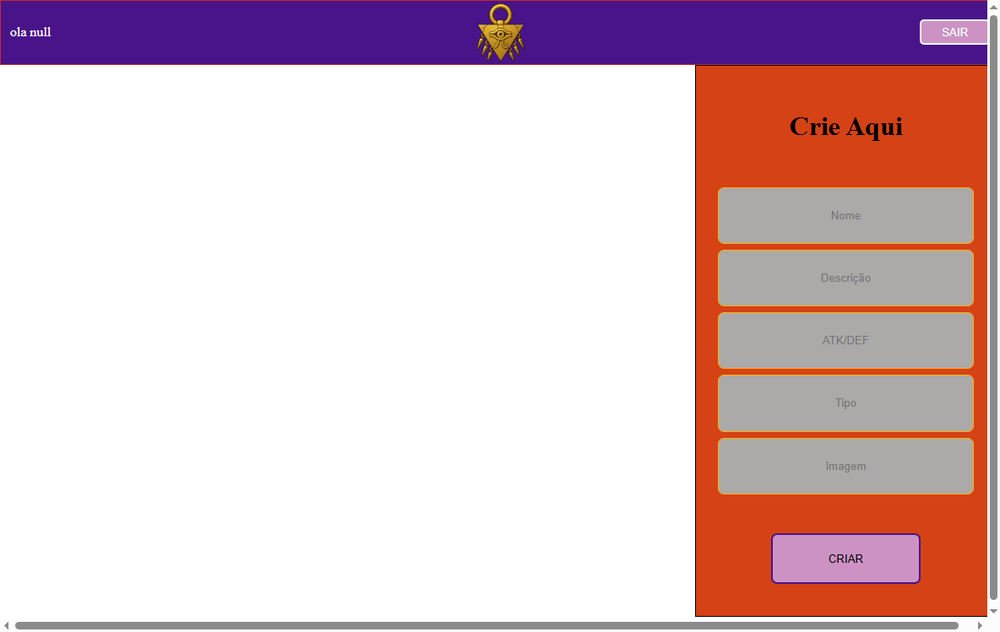
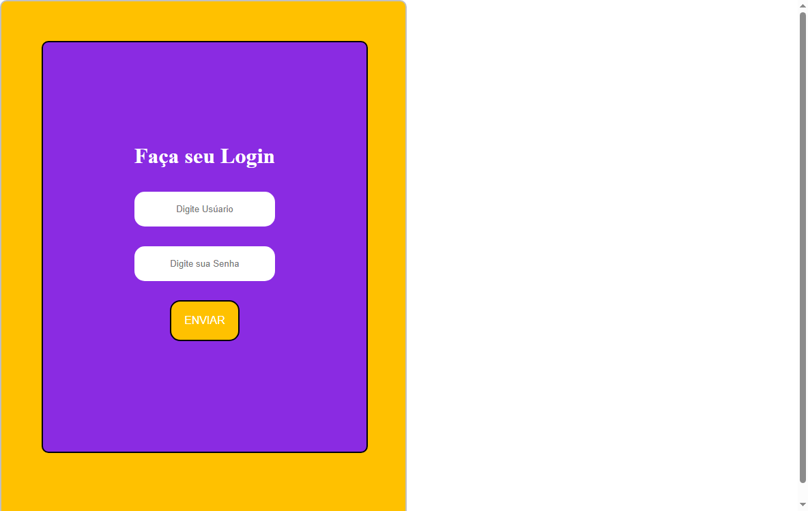

# 🎴 Yu-Gi-Oh! Card Creator & Deck Hub

<div align="center">


<p align="center">
  Uma aplicação full stack para autenticação de duelistas e criação personalizada de cartas inspiradas no universo de Yu-Gi-Oh!
</p>

<p align="center">
  
  
</p>

[Visão Geral](#-visão-geral) •
[Funcionalidades](#-funcionalidades) •
[Tecnologias](#-tecnologias) •
[Arquitetura](#-arquitetura-do-projeto) •
[Como Executar](#-como-executar-o-projeto) •
[Endpoints da API](#-principais-endpoints) •
[Autor](#-autor)

</div>

---

## 📖 Visão Geral

O **Yu-Gi-Oh! Card Creator** é um sistema completo desenvolvido com arquitetura web full stack. A plataforma conta com autenticação de usuários (cadastro e login), persistência segura de dados relacionais e uma interface dinâmica para gerenciamento e criação de cartas com atributos clássicos (Nome, Descrição, ATK/DEF, Tipo e Imagem).

---

## ✨ Funcionalidades

- 👤 **Autenticação de Usuários:** Cadastro e login de duelistas com validação.
- 🃏 **Criação de Cartas Customizadas:** Geração dinâmica de cartas com título, descrição, pontos de ataque/defesa, tipo e imagem.
- 💾 **Persistência em Banco de Dados:** Armazenamento relacional de usuários e cartas utilizando MySQL e JPA / Hibernate.
- ⚡ **API RESTful:** Backend em Spring Boot estruturado para comunicação assíncrona com o frontend via `fetch` API.
- 🎨 **Interface Temática:** Design imersivo estilizado com CSS customizado inspirado no universo Yu-Gi-Oh!.

---

## 🛠 Tecnologias Utilizadas

### **Frontend**
- **HTML5 & CSS3:** Telas de Login, Cadastro e Painel Principal responsivas com estilização temática.
- **JavaScript (ES6+):** Manipulação dinâmica de DOM e consumo da API REST via requisições assíncronas.

### **Backend**
- **Java 21:** Versão moderna com recursos avançados de tipagem e performance.
- **Spring Boot:** Framework robusto para construção dos serviços backend.
- **Spring Data JPA / Hibernate:** Abstração e gerenciamento da camada de persistência.
- **Maven:** Gerenciamento de dependências e build.

### **Banco de Dados**
- **MySQL:** Banco de dados relacional para estruturação e armazenamento consistente.

---

## 📁 Arquitetura do Projeto

```text
Cards-Yugioh/
├── Backend/                    # Servidor REST (Spring Boot)
│   ├── src/
│   │   ├── main/
│   │   │   ├── java/           # Código-fonte Java (Controllers, Services, Models, Repositories)
│   │   │   └── resources/      # Configurações (application.properties)
│   └── pom.xml                 # Dependências Maven
├── Cadastro.html               # Tela de Registro de Duelistas
├── Login.html                  # Tela de Acesso
├── Inicial.html                # Painel de Criação e Visualização de Cartas
├── Style.css & Style2.css      # Estilização visual
├── script.js, script2.js, ...  # Lógica e integração com o backend
└── README.md                   # Documentação do projeto
```

---

## 🚀 Como Executar o Projeto

### Pré-requisitos
Antes de começar, você precisará ter instalado em sua máquina:
- [Git](https://git-scm.com)
- [Java JDK 21](https://www.oracle.com/java/technologies/downloads/)
- [MySQL Server](https://dev.mysql.com/downloads/mysql/)

### 1. Clonar o repositório
```bash
git clone https://github.com/nycolas007el/Cards-Yugioh.git
cd Cards-Yugioh
```

### 2. Configurar o Banco de Dados
No seu gerenciador MySQL, crie o banco de dados do projeto:
```sql
CREATE DATABASE yugioh_db;
```

Ajuste as credenciais no arquivo `Backend/src/main/resources/application.properties` (ou correspondente):
```properties
spring.datasource.url=jdbc:mysql://localhost:3306/yugioh_db
spring.datasource.username=seu_usuario
spring.datasource.password=sua_senha
spring.jpa.hibernate.ddl-auto=update
```

### 3. Iniciar o Backend (Spring Boot)
```bash
cd Backend
./mvnw spring-boot:run
```
> O servidor iniciará por padrão em `http://localhost:8080`.

### 4. Executar o Frontend
Basta abrir o arquivo `Login.html` diretamente em seu navegador web (ou utilizando a extensão **Live Server** no VS Code).

---

## 🔌 Principais Endpoints

| Método | Endpoint | Descrição |
| :--- | :--- | :--- |
| `POST` | `/usuarios/login` | Autenticação do usuário |
| `POST` | `/usuarios/cadastrar` | Registro de novos usuários |
| `GET` | `/cards` | Listagem de todas as cartas cadastradas |
| `POST` | `/cards` | Criação de uma nova carta |

---

## 👨‍💻 Autor

Feito com dedicação por **Nycolas**!

[](https://github.com/nycolas007el)
[](https://www.linkedin.com/in/nycolas-moreira-286206343/)
